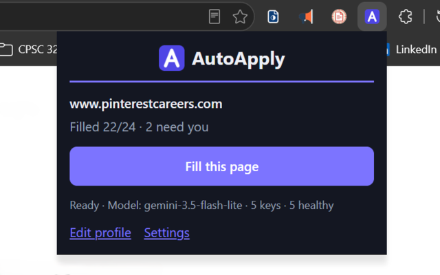
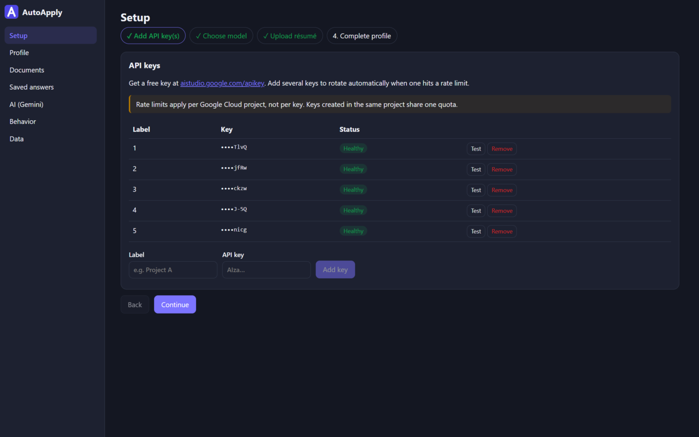
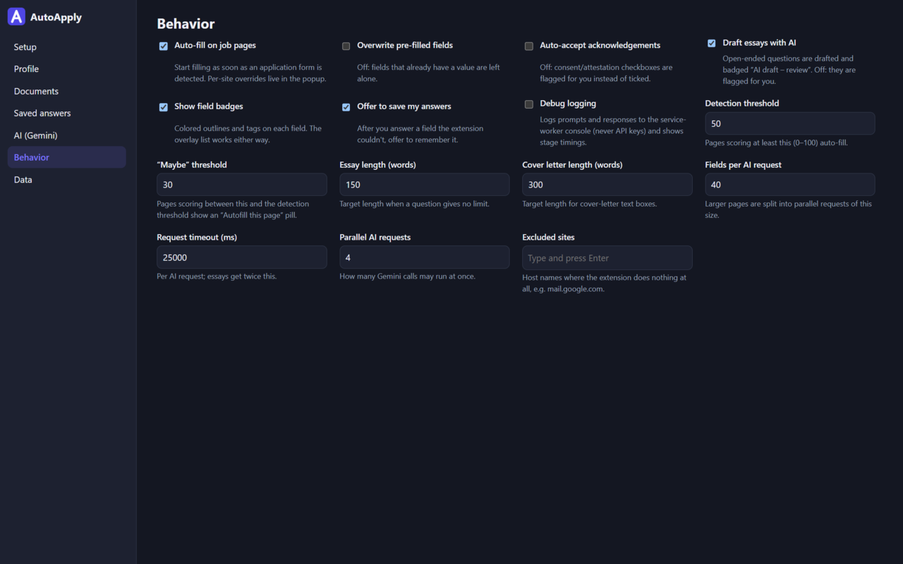

<div align="center" markdown="1">


# AutoApply

A Chrome extension (Manifest V3) that fills job applications from your profile with Google Gemini or Claude. Fill and submit applications yourself, or let **YOLO mode** find jobs and apply automatically, with optional review before submission.

[](https://chromewebstore.google.com/detail/autoapply/bhonoldmpmcmajclbndlpkijmnklgnlf)

[](#gemini)
[](#claude-through-claude-code)
[](PRIVACY.md)
[](LICENSE)
[](https://github.com/ExxML/AutoApply/actions/workflows/ci.yml)

### Check out [AutoApply on Chrome Web Store](https://chromewebstore.google.com/detail/autoapply/bhonoldmpmcmajclbndlpkijmnklgnlf)!

</div>

## Table of contents

- [App preview](#app-preview)
- [Features](#features)
- [Install and first setup](#install-and-first-setup)
- [AI providers and usage limits](#ai-providers-and-usage-limits)
- [Profile](#profile)
- [Documents, résumés and cover letters](#documents-résumés-and-cover-letters)
- [Manual autofill](#manual-autofill)
- [Answer policies and safeguards](#answer-policies-and-safeguards)
- [Behavior settings](#behavior-settings)
- [YOLO mode](#yolo-mode)
- [Applications and recovery](#applications-and-recovery)
- [Saved answers and backups](#saved-answers-and-backups)
- [Privacy and permissions](#privacy-and-permissions)
- [Compatibility and limitations](#compatibility-and-limitations)
- [Troubleshooting](#troubleshooting)
- [How it works](#how-it-works)
- [Development](#development)
- [License](#license)

## App preview

<div align="center">
  
  
</div>

<div align="center">
  
</div>

## Features

| Feature                   | What it does                                                                                                                                     |
| ------------------------- | ------------------------------------------------------------------------------------------------------------------------------------------------ |
| Manual autofill           | Fill the current page from the popup or a keyboard shortcut; review the results and click Next or Submit yourself.                               |
| Form support across sites | Match fields by labels, context and meaning, including native controls, custom dropdowns, typeaheads, repeated sections, iframes and shadow DOM. |
| Gemini, Claude or both    | Use your own Gemini API keys, your Claude plan through Claude Code, or Gemini for autofill alongside Claude for writing and review.              |
| Profile and saved answers | Reuse structured personal information and previously saved answers; unambiguous matches fill locally without an AI request.                      |
| Essays and cover letters  | Draft answers within the question's limits and generate cover letter PDFs using your profile, résumé, job description and writing guidance.      |
| Résumé choices            | Select a suitable uploaded résumé without AI, tailor a LaTeX résumé to the job and compile it locally, or leave manual uploads to you.           |
| AI form review            | Check filled pages against your profile, correct mistakes and fill missed fields; manual and YOLO review have separate switches.                 |
| YOLO applications         | Discover matching jobs, manage site accounts, fill multi-step applications and submit automatically or hold them for your review.                |
| Queue and job tabs        | Add posting links yourself, control queue order, apply only queued jobs, or work through job postings already open in your browser.              |
| Application tracking      | Track automatic and manual submissions, pending reviews, guessed answers, source reports, failures and resumable applications.                   |
| Local data and backups    | Keep data in this browser, export JSON backups and preview individual changes before importing.                                                  |

AutoApply uses a general form engine across job sites. The ATS names below describe discovery integrations and examples, not a restriction on where autofill works. See [compatibility and limitations](#compatibility-and-limitations) for cases that need manual input.

## Install and first setup

Install from the [Chrome Web Store](https://chromewebstore.google.com/detail/autoapply/bhonoldmpmcmajclbndlpkijmnklgnlf), or build an unpacked copy.

**Source installation requirements:** Node.js 20+ and Chrome/Chromium 120+.

```bash
git clone https://github.com/ExxML/AutoApply.git
cd AutoApply
npm install
npm run build
```

1. Open `chrome://extensions` and enable **Developer mode**.
2. Click **Load unpacked** and select the generated `dist/` folder.
3. Follow the **Setup** wizard, which opens on first install: configure an AI provider, upload a résumé and complete your profile.
4. Open a job application and choose **Fill this page**.

Other Chromium browsers with Manifest V3 support may work; Chrome/Chromium is the test target. Claude's bridge installer also supports Edge and Brave.

| Default shortcut | Action                               |
| ---------------- | ------------------------------------ |
| **Alt+Shift+A**  | Open the toolbar popup               |
| **Alt+Shift+F**  | Fill the current page                |
| **Alt+Shift+W**  | Expand or collapse the in-page panel |

Change shortcuts at `chrome://extensions/shortcuts` if another app or extension uses them.

## AI providers and usage limits

Choose the provider in **Settings → AI**. It controls autofill, essay and cover letter drafting, résumé import and tailoring, AI form review, and YOLO screening/navigation.

### Gemini

1. Create a key in [Google AI Studio](https://aistudio.google.com/apikey).
2. In **Setup** or **AI**, enter a label and the key, then click **Add key**. AutoApply checks it by requesting the model list; invalid keys show Google's error.
3. Choose a **Primary model**. Picking a model runs a validation request.
4. Optionally choose a **Fallback model** and a **Review model**.

The searchable model list contains text models supporting `generateContent`, excluding embedding, image, audio, live, TTS and Gemma models. Models are ordered by when AutoApply first saw them, newest first. A Flash-Lite model is selected initially when available. **Refresh list** fetches the catalog again; opening the picker also refreshes a catalog older than a day.

The review model handles AI form review and YOLO's AI navigation. Leaving it unset uses the primary model. The fallback model is used when the primary model's available keys or retries cannot complete a request.

Add multiple keys to rotate automatically around rate limits and quota exhaustion. Each row shows its health, including cooldowns, daily quota exhaustion for a model, invalid keys and model availability. Daily quota resets are tracked at midnight Pacific time.

> Keys from the same Google Cloud project share quota. More keys in one project do not provide independent capacity. See [Gemini API rate limits](https://ai.google.dev/gemini-api/docs/rate-limits) for quota details.

### Claude through Claude Code

Use your own Claude Pro or Max plan without an API key:

1. Install [Claude Code](https://code.claude.com/docs/en/setup), run `claude` in a terminal and sign in.
2. Select **Claude** in **Settings → AI**.
3. Copy the bridge setup command shown there into PowerShell on Windows or Terminal on macOS/Linux. **What this runs** exposes the installer; **Uninstall** gives its removal command.
4. Click **Connect** and grant native messaging access. AutoApply restarts and reopens the page to test the connection.

The bridge is installed at `%LOCALAPPDATA%\AutoApply\claude-bridge` on Windows or `~/.autoapply/claude-bridge` on macOS/Linux, and registers with supported browsers. It is tied to the extension ID; rerun setup if moving an unpacked extension changes that ID.

Each request runs your installed `claude -p` with tools, MCP servers, plugins, hooks and memory disabled and session persistence turned off. AutoApply does not receive your Claude sign-in credentials.

Under **Models**, select a model and effort separately for:

| Work                            | Includes                                                                              |
| ------------------------------- | ------------------------------------------------------------------------------------- |
| Autofill & YOLO screening       | Field answers, dropdown choices, answer checks, best guesses and job relevance checks |
| Essays & cover letters          | Essays, generated cover letters and résumé tailoring                                  |
| Résumé import                   | Proposing profile values from résumé text                                             |
| Answer review & YOLO navigation | Reviewing filled pages and finding the next step on unfamiliar pages                  |

The model list comes from Claude Code; **Refresh list** updates it without an extension release. **Default** uses Claude Code's own setting. The review task defaults to Opus with High effort. Larger models and higher effort generally use more time and plan capacity; every call also starts a Claude Code process. If an older bridge only shows built-in model aliases, rerun setup.

### Claude with Gemini autofill

With Claude selected, enable **Models → Autofill with Gemini**, then configure Gemini keys and models below it. Gemini handles the autofill/screening tasks; Claude still handles writing, résumé import/tailoring, page review and AI navigation. When Gemini has no usable keys or exhausts its quota, these autofill tasks fall back to Claude.

AI review remains a separate setting. Turning it off also removes Claude's second check of Gemini-filled answers.

### When usage runs out

If any AI workflow step exhausts its available usage, autofill stops with a warning and YOLO (including job tabs) pauses until the reset. This includes reviews and navigation, even when Gemini can still fill fields. Résumé tailoring also stops on exhausted usage instead of uploading the untailored fallback.

Configured key, model and provider fallbacks are tried before usage is considered exhausted. Manual autofill can retry automatically when the reset is within 90 seconds; YOLO requeues the interrupted job and releases its hidden application page while paused. The popup and in-page panel show the warning or next retry time. A failure in an optional AI step does not permit the application to continue past an exhausted usage limit.

## Profile

Profile changes save automatically. Fill in the structured fields you want AutoApply to use; each has help text explaining its purpose.

| Profile section     | Information used                                                                                                                                                                           |
| ------------------- | ------------------------------------------------------------------------------------------------------------------------------------------------------------------------------------------ |
| Personal            | Legal/preferred names, pronouns, birth date, email, phone, address and LinkedIn/GitHub/portfolio/other links                                                                               |
| Work authorization  | Authorization and current/future sponsorship per country, citizenship context, security clearance and age eligibility                                                                      |
| Education           | Multiple schools/degrees, enrollment, graduation, GPA, courses, awards, credits and high school                                                                                            |
| Co-op / internship  | Program, work-term number, available terms, acceptable term lengths and student number                                                                                                     |
| Experience          | Multiple roles with employer, title, location, dates, current status and descriptions                                                                                                      |
| Projects            | Names, links, technologies and descriptions                                                                                                                                                |
| Extracurriculars    | Clubs, volunteering, organizations, roles, dates and achievements                                                                                                                          |
| Skills              | Technical/soft skills, languages with proficiency and certifications                                                                                                                       |
| Preferences         | Relocation, locations, work arrangements, availability, compensation, travel, notice, employment types, hours, weekends and shifts                                                         |
| Background          | Driving/vehicle access, background/drug checks, criminal record, company ties, restrictions, deadlines, outside activities, government ties and communication/recording/AI-review consents |
| Referral            | Default source and an actual referrer's name                                                                                                                                               |
| Self-identification | Voluntary demographic, disability, veteran and related answers, including decline-to-answer choices                                                                                        |
| Essay guidance      | Bio, goals, strengths, tone, things to avoid and a cover letter template                                                                                                                   |

**Unset** differs from **No**. Eligibility and sensitive information require explicit profile values; missing values are left for you. **Decline** selects a prefer-not-to-say option when the form offers one.

Compensation settings support a minimum acceptable amount and a strategy for a posting's pay range: minimum, lower quarter, midpoint, upper quarter or maximum. The target does not go below your configured minimum. Hourly/yearly amounts are converted using 40 hours × 52 weeks when needed.

**Prefill Profile using extracted résumé**, available in Setup and Documents, uses AI to propose values for empty fields. Review the proposed values and select what to keep; existing profile values are preserved.

## Documents, résumés and cover letters

### Document library

In **Documents**, upload PDF, DOCX or TXT files up to **5 MB each**, label them, and choose **Résumé**, **Cover letter**, **Transcript** or **Other**. You can change document labels/kinds, download files or delete them. Only PDF résumés can be marked as the primary résumé.

PDF text is extracted locally with pdf.js; TXT text is read locally. DOCX files can be uploaded but have no text extractor. The editable **Résumé text** supplies context for answers and essays: correct extraction errors there. **Reload** replaces it from your primary PDF or the original compiled AI-tailoring résumé, with confirmation before replacing existing text. Image-only PDFs may have no extractable text.

Uploads are matched to the requested document kind and accepted file types. A stored cover letter is used before generating one.

### Résumé upload modes

Manual autofill and YOLO have separate **Upload résumés** settings in **Behavior** and **YOLO Mode → Applying**.

| Mode                          | Behavior                                                                                                                                                                          |
| ----------------------------- | --------------------------------------------------------------------------------------------------------------------------------------------------------------------------------- |
| **Variant select** (default)  | Selects the best-fitting résumé document using its label and extracted text against the job title/description. No AI request; the primary résumé wins when no variant stands out. |
| **AI tailor**                 | Tailors your uploaded LaTeX résumé to the job, compiles it locally to PDF and uploads the result while the rest of the form fills.                                                |
| **Flag for me** (manual only) | Leaves résumé uploads for you. YOLO requires a configured résumé upload method.                                                                                                   |

For **AI tailor**, upload a self-contained pdfLaTeX `.tex` file up to **1 MB** under **Documents → Résumé for AI tailoring**. It is checked and test-compiled on upload. Article-based templates such as Jake's Resume and supported moderncv styles work with the bundled packages; templates requiring XeLaTeX/LuaLaTeX, external images or extra input files do not.

The editable **AI tailoring prompt** controls the changes, with a reset to the default prompt. The default permits focused rewording and reordering while prohibiting invented or exaggerated experience. The engine applies validated edits to the résumé body and preserves the template's preamble/layout and protected headings. Tailoring uses the writing model.

You can upload a separate **fallback PDF** up to 5 MB. Otherwise the PDF compiled from your original `.tex` file is the fallback. Ordinary errors, missing job context or unusable edits use that fallback; exhausted AI usage stops the application.

**Keep the tailored résumé to one page** is on by default and applies to manual and YOLO tailoring. The AI ranks possible cuts, and the engine compiles to find the fewest ranked cuts that fit. It never uploads a tailored or fallback résumé over one page while this setting is on; an unreadable or oversized fallback leaves the upload for you. With the setting off, a tailored résumé still cannot exceed the original résumé's page count. This setting does not shorten documents uploaded through Variant select.

### Essays and cover letters

Open-ended answers use your profile, résumé text, job description and essay guidance, and honor detected word/character limits. Default targets when no limit is given are **150 words for essays** and **300 for cover letters**, adjustable under **Profile → Essay guidance**.

The **Cover letter template** is an optional starting point for cover letter text boxes and generated PDFs. General essay questions do not receive that template.

- **Manual autofill:** **Draft essays with AI** is on by default. **Behavior → Write cover letters** is off by default; enable it to generate a PDF when there is no uploaded cover letter.
- **YOLO:** required cover letter uploads get a generated PDF when there is no stored letter. **Write optional cover letters** also generates optional uploads and is off by default.
- **One-page PDFs:** **Keep generated cover letters to one page** is on by default. A letter that overflows is rewritten shorter once; if it still does not fit, it is not uploaded. This applies to generated PDFs, not your uploaded documents.

## Manual autofill

1. Open an application page and click **Fill this page** or press **Alt+Shift+F**.
2. AutoApply scans visible fields across the page, frames and shadow DOM. Unambiguous profile matches, saved answers, known document uploads and consent choices are resolved locally first.
3. Remaining questions go to the selected AI provider in batches. Choices are matched by meaning, including negatively phrased questions; custom dropdowns and typeaheads are operated as needed.
4. Essay drafts and document generation run where enabled. Entered values are checked against what the page shows.
5. With **Review manual fills with AI** enabled (default), the review model reads a text representation of the filled page, checks answers against your profile, corrects eligible values and fills missed fields. It can add repeated entries where your profile supplies them. Unresolved items include a reason.
6. Review the in-page panel and field badges. Click a **Needs you** row to jump to the field, edit answers directly, or use **Re-run** for unresolved/new fields. **Stop** cancels the current fill.
7. Click the site's **Next** yourself. Trigger another fill for the next step or newly revealed fields, then submit when ready.

Manual mode never clicks Next or Submit. It starts only when requested, including a retry of an existing run; it does not continuously scan or watch for form changes between fills. Fields you edit are treated as yours and protected from subsequent autofill/review. Existing values are also left alone by default.

### Field badges

| Badge                | Meaning                                                                                         |
| -------------------- | ----------------------------------------------------------------------------------------------- |
| Green **✓**          | Filled locally from your profile or a saved answer; user answers may show **You** or **Saved**  |
| Blue **AI**          | AI-matched answer; hover for its explanation and source profile fields                          |
| Purple **AI draft**  | AI-written prose to review; click the tag to save it as a reusable answer                       |
| Yellow **Needs you** | Missing/uncertain information, a protected field, a consent left for you or an AI refusal       |
| Orange **Check**     | Verify a screening-policy/best-guess answer, or a value that does not match what the page shows |
| Red **Failed**       | AutoApply could not enter the value                                                             |

The bottom-right panel reports progress, model, notices and unresolved fields. It also lists uploaded résumés and cover letters: click a filename to open it, or expand **Job details the AI used** to inspect the context behind a generated document. Failed tailoring/cover letter items can offer **Regenerate**. **Alt+Shift+W** toggles the panel's expanded view. Turning off field badges leaves the panel available.

## Answer policies and safeguards

### Screening answers

Manual and YOLO autofill choose answers that meet a job's screening requirements, preferences and recommendations unless a dedicated structured Profile field explicitly contradicts them. For example, “All” acceptable term lengths permits a three-month minimum, and a three-year React requirement can take precedence over weaker claims in résumé prose, essay guidance or saved answers. Explicit term lengths and availability dates still apply.

These policy-derived answers are marked **Check**, and YOLO includes them in the application log. This policy can produce answers beyond what your résumé states: review them, and use explicit structured profile values to express constraints.

YOLO additionally makes best guesses for otherwise unanswered questions, favoring an answer that helps obtain an interview. Those answers also appear as **Check** and are listed with the application. Work authorization, sponsorship, age, criminal-record, clearance, demographics and consent safeguards still apply.

### Honeypots and untrusted page instructions

AutoApply skips detected hidden/concealed honeypot controls and AI-only trap fields. Page text is sanitized to remove recognized instructions aimed at bots or language models, including attempts to override the AI's instructions. Review and navigation use the same safeguards; generated drafts that identify themselves as AI responses are rejected.

Payment and government-ID numbers are left for manual entry. Ordinary autofill skips password controls; YOLO's separate account workflow can create and enter saved site credentials. Safeguards are detection-based and do not guarantee recognition of every possible trap.

### Consents

Required application consents and attestations are **accepted by default**. Turn off **Behavior → Auto-accept required consents** to flag them instead.

Optional consents have a separate **Auto-decline** (default), **Auto-accept** or **Flag for me** setting. Explicit profile choices for interview recording, AI assessment, new job opportunities and marketing guide their matching questions. Unset or required communication opt-ins follow the applicable consent settings. AI form review does not override protected consent or sensitive-field decisions.

## Behavior settings

| Setting                       | Default / effect                                                                          |
| ----------------------------- | ----------------------------------------------------------------------------------------- |
| Overwrite pre-filled fields   | Off; leave existing values alone                                                          |
| Auto-accept required consents | On                                                                                        |
| Optional consents             | Auto-decline                                                                              |
| Draft essays with AI          | On                                                                                        |
| Write cover letters           | Off for manual PDF generation                                                             |
| Upload résumés                | Variant select; separate YOLO choice                                                      |
| Review manual fills with AI   | On; YOLO review is configured separately                                                  |
| Show field badges             | On                                                                                        |
| Offer to save my answers      | Off; enable prompts to remember answers you enter for flagged questions                   |
| Fields per AI request         | 40; adjustable from 1–200, with larger pages split into parallel batches                  |
| Request timeout               | 25,000 ms; essays receive twice the timeout and Claude has an additional multiplier       |
| Parallel AI requests          | 4; adjustable from 1–16                                                                   |
| Debug logging                 | Off; adds stage timings, service-worker prompt/response logs and retained YOLO debug logs |
| Debug logs kept               | 100 recent applications; adjustable from 1–500                                            |
| Excluded sites                | Hostnames on which AutoApply is disabled                                                  |

Higher batch sizes/concurrency can increase provider pressure. Review and AI navigation add requests; saved answers, local matching and résumé Variant select avoid AI calls for those decisions.

## YOLO mode

YOLO can submit applications automatically. Configure **Settings → YOLO Mode**, including your search queries, AI provider, profile and résumé, before turning it on in the popup. It runs while the browser is open.

### Schedule and discovery

The defaults are **one batch every 30 minutes**, **3 applications per batch** and postings from the last **14 days**. The interval is adjustable from **5–1,440 minutes**, batch size from **0–500**, and posting age from **1–90 days**. A batch size of **0** discovers jobs without applying.

Search filters include:

- **Search queries:** a title must contain every word of at least one query, allowing supported plurals/synonyms such as intern/internship/co-op.
- **Locations:** countries, regions or cities; empty accepts anywhere. Use full names and disambiguate repeated city names where possible.
- **Include remote jobs**, excluded title words and skipped companies.
- **Check matches with AI** (on by default): screens job title, company and location against your queries, education, work authorization, country and relocation preference. It does not read full descriptions at this stage; uncertain/ordinary failed checks keep the job.
- **Remember AI rejections:** 90 days by default, adjustable from 1–365. Disabling new AI checks does not immediately clear remembered rejections.

| Source                            | How it is read                                                                                                               |
| --------------------------------- | ---------------------------------------------------------------------------------------------------------------------------- |
| GitHub job lists                  | Raw SimplifyJobs-format `listings.json` feeds or README job tables; the SimplifyJobs internship feed is configured initially |
| LinkedIn, Glassdoor, ZipRecruiter | Searches for your queries and locations without using a signed-in account                                                    |
| Indeed                            | Searches using your sign-in in this browser; signed-out/blocked sources are reported                                         |
| Jobright                          | Your signed-in recommendations, based on Jobright preferences; the other applicable AutoApply filters still apply            |
| Company career sites              | Workday, Greenhouse, Lever, Ashby and SmartRecruiters board APIs; other pages are opened once and their job links read       |

For a company site, enter its actual listings/search page. Generic pages are not paginated or clicked through; a search URL can include `{q}` for your query. Board jobs are routed to employer applications; LinkedIn Easy Apply is not supported.

If Indeed requires a bot check during discovery, AutoApply can open the search in front, notify you and wait up to 10 minutes for you to complete it. It does not solve the challenge.

### Queue controls and starting batches

Open **Applications → Queued jobs** to search the queue, open postings, remove individual jobs, clear the queue or **Add jobs** by pasting one or more posting links. Company/title are read from each posting; missing details are requested. Manually added jobs bypass discovery search/title/date/fit filters, while duplicate and application safeguards remain.

Choose **Apply order**: newest posted, oldest posted, first found, last found or random. **Rank by source first** lets you move source groups into priority order. Jobs you add can go at the front (default), at the end or wherever the normal ordering puts them. Retried jobs retain priority. Removing a job only drops it for now; discovery may find it again.

| Popup action          | What happens                                                                                                                          |
| --------------------- | ------------------------------------------------------------------------------------------------------------------------------------- |
| **YOLO Mode On/Off**  | Enable or disable scheduled discovery and queue applications                                                                          |
| **Force start batch** | Start a fresh batch now, including discovery, and reset the next batch timer                                                          |
| **Apply queued jobs** | Turn YOLO on if needed and start a fresh batch from the existing queue only; skip source checks, discovery and top-ups for that batch |

**Apply queued jobs** requires at least one configured search query, a nonempty queue, a positive batch size and a configured résumé. It uses up to the configured batch budget; the next scheduled batch occurs a full interval later and discovers jobs normally. Ordinary batches can top up a short queue before the next scheduled batch.

### Apply to open job tabs

**YOLO apply to job tabs** in the popup reads job postings in the current browser window and applies to them in their existing tabs, one at a time. It works with scheduled YOLO off and runs ahead of the regular queue, without its batch-size limit.

These jobs bypass discovery filters and retain duplicate checks and submission-review rules. The popup reports non-job tabs and skipped postings. **Stop now** cancels the active tab run and waiting tabs; **Stop after this tab** lets the current application finish first. The waiting-tab list is session-only and is discarded on browser restart.

### Filling and navigation

YOLO opens Apply, handles supported account/sign-in steps, fills and reviews each page, advances through the application and submits unless a human-review rule holds it.

- Automatic applications normally use one hidden page at a time. **Retry in a background tab** (on by default) retries sites that cannot work hidden in an inactive tab, and remembers those hosts for later jobs.
- **Review YOLO fills with AI** and **Use AI navigation when stuck** are both on by default and independent. They use the review model configured under AI.
- **YOLO email** overrides the profile email for YOLO applications/accounts; empty uses your profile email.
- Required documents use your YOLO résumé and cover letter settings. Missing protected information or unresolved challenges can leave the application under **Needs you**, with a desktop notification.
- **Real input on bot-checked pages** is off by default. Choose Clicks, Typing or Both to send supported input through Chrome's debugger in application tabs. Chrome displays a debugging bar while attached; cancelling it disables real input for that job and falls back to script input. It is not used in hidden frames and does not solve CAPTCHAs.

### Accounts and email verification

YOLO generates and saves passwords when a site requires account creation, and reuses saved credentials on later visits. Under **YOLO Mode → Site accounts**, reveal/delete credentials or **Add account** for an account you created yourself. Workday accounts are scoped per company.

Passwords are encrypted with a key held in this browser and are not included in JSON exports.

**Use emailed access codes** and **Open job verification links** are on by default, but need a suitable Gmail connection:

- Codes can be read from the YOLO address's Gmail inbox when it is signed in to this browser.
- Verification links require the read-only Gmail API connection. The settings page provides setup instructions for your OAuth client ID, client secret and the exact redirect URI. The secret allows the connection to survive extension reloads/browser restarts.
- Each feature can be disabled separately. Emails are read when a run is blocked on verification, rather than monitored continuously. Links are limited to the job's own sites; a tracking redirect to an unrelated site stops the run.

Without the required email access, applications needing verification wait for you.

### Review before submission

This is **off by default** and independent of AI form review. In **YOLO Mode → Review before submission**, choose:

- **All applications**, or
- **Matching applications**, using any combination of sources, US Fortune 500/1000 membership, named companies, or guessed/screening-policy answers.

Any matching rule holds submission. Ordinary profile-based essays and cover letters do not count as guessed answers. Company matching uses normalized whole names and verified aliases; Fortune matching uses a bundled, dated US ranking, with no runtime ownership lookup or extra AI call. Add unlisted subsidiaries by company name.

Review-capable applications use inactive tabs so answers and file uploads remain available. **Maximum pending reviews** defaults to **10** (range **1–50**); at the limit, new applications pause while discovery continues. Selecting Matching applications with no rules also pauses new applications.

Find held applications under **Applications → Ready for your review**, open **Review application**, edit the live form and use the site's Submit button. Rules are captured when a run starts, and held applications remain manual even if you later disable YOLO or change rules.

Preparing a review consumes one batch slot; submitting it yourself does not consume another. Keep review tabs open: refreshing, closing, a crash or a browser restart can lose answers/uploads. **Refill for review** explicitly rebuilds a missing form, may lose previous edits and always stops before submission. **Dismiss & close tab** skips the application while retaining duplicate protection.

## Applications and recovery

**Applications** combines YOLO outcomes, submissions detected after your manual fills and applications you record yourself. It shows:

- **Batch**, **Today** and **All time** totals for submitted/attempted applications, failures and pending work; skipped postings are excluded from attempt totals.
- Search and status filters: **Submitted**, **Needs you**, **Failed**, **Skipped** and **Ready for your review**.
- Reasons, guessed/screening-policy answers, review reasons, and notes such as résumé-tailoring results.
- **Last source check**, with per-source found/new/matched/queued counts, filtering reasons and sign-in/fetch problems.

**Add application** records a job you submitted outside AutoApply; those records always prevent YOLO from applying again. Duplicate detection also uses posting identities, employer links and company/title matching across sources. **Re-apply to jobs I submitted myself** is off by default for submissions detected after manual autofill. **Warn me on jobs already applied to** is on by default.

| Recovery action                            | Effect                                                                                                                                         |
| ------------------------------------------ | ---------------------------------------------------------------------------------------------------------------------------------------------- |
| **Resume**                                 | Open an unfinished/failed application in a tab and continue                                                                                    |
| **Resume all**                             | Queue all Needs you or Ready for your review applications of the selected status, including rows hidden by filters; process them one at a time |
| **Review application / Refill for review** | Return to a live held form, or explicitly rebuild it for manual submission                                                                     |
| **Mark submitted**                         | Record that you already submitted on the job site                                                                                              |
| **Forget**                                 | Remove a history entry so the job may become eligible again                                                                                    |
| **Forget all**                             | After confirmation, remove all Failed, Needs you or Skipped entries of the selected status, including filtered-out rows                        |

When **Behavior → Debug logging** is enabled, **Applications → Debug logs** shows retained application details, answers and captured files available to download. The retention limit is configurable. Service-worker prompts/responses and debug files can contain personal/application information.

## Saved answers and backups

### Saved answers

Enable **Behavior → Offer to save my answers** to be prompted after answering a flagged question yourself. AI-draft badges can also save a draft as a reusable answer. Matching saved answers fill locally on later applications.

Under **Saved Answers**, search by question, answer or host, edit an answer, view when it was saved or delete it. Explicit profile constraints and screening/sensitive-field policies still take precedence where applicable.

### Export, import and reset

**Data → Export JSON** backs up your profile, saved answers, settings, models, documents, application history, queue and supported discovery state. **Include API keys** and **Include documents** are both checked by default; clear either to omit those items. Included tailoring documents cover the source, compiled original and separate fallback PDF.

**Import** validates an AutoApply JSON export and shows a searchable before/after preview grouped by page and section. Select individual values/list entries or groups of changes, inspect downloadable documents, and leave unchecked values untouched. Identical values are omitted and secrets stay masked until revealed. Importing YOLO preferences turns scheduled YOLO off until you enable it again.

Browser-specific connection state, active review tabs and debug logs are not transferable backups; reconnect Claude/Gmail and rebuild lost review forms when needed. Site-account passwords and their encryption key are not exported.

**Reset everything** clears extension data and the local password-vault key after repeated confirmation. Uninstalling or clearing extension storage also loses local data, so keep an export and copies of important documents.

## Privacy and permissions

Your profile, documents, settings, saved answers, application history and encrypted site credentials are stored in this browser, primarily in `chrome.storage.local`. The password-vault key is held separately in local IndexedDB. There is no AutoApply server, analytics or telemetry.

To answer questions, AutoApply sends relevant profile information, résumé text, saved answers, field labels/options, job context and, for review/navigation, a textual page snapshot to your configured provider:

- **Gemini:** directly to Google under your API keys.
- **Claude:** through your local bridge and signed-in Claude Code to Anthropic.
- **Hybrid:** to each provider for its configured tasks.

Local matching, PDF text extraction, résumé-variant selection and LaTeX compilation happen locally. Job sites receive the values and documents you enter/upload; YOLO contacts enabled discovery sources and, when needed, verification-email services.

API keys are kept out of content scripts and page code, masked in settings after entry and never written to debug logs. JSON exports **include them by default** unless you clear the checkbox; YOLO OAuth client settings may also be included, so treat backups as private.

The extension requests broad site access because applications can be hosted anywhere. Storage, tabs, alarms, offscreen pages, notifications, tab groups and request-rule permissions support autofill/YOLO; identity supports Gmail. The debugger permission supports optional real input and is declared at installation even when that setting is off. **Native messaging** is requested when connecting Claude.

## Compatibility and limitations

- Autofill is designed for varied job sites through a general scanner/filler/reviewer. No list of supported ATSs guarantees every form or widget will work.
- Browser-internal/restricted pages cannot be filled. Host exclusions and browser site-access settings can also prevent AutoApply from running.
- Custom calendar widgets that reject typed dates, some synthetic-event-resistant controls, cross-origin upload dropzones and uploaders requiring an OS action may need manual input.
- CAPTCHAs and unresolved bot checks require you; real input and tab fallback do not guarantee a site's acceptance.
- Government IDs and payment numbers are manual. Account passwords are handled only through YOLO's separate authentication workflow.
- Discovery can miss small or ambiguous locations; generic career pages are read once without pagination. AI relevance screening uses listing metadata, not full descriptions.
- LinkedIn Easy Apply is unsupported; use an employer's posting link.
- Résumé tailoring needs supported, self-contained pdfLaTeX. DOCX résumé text is not extracted, and scanned PDFs may need manually supplied résumé text.
- Generated cover letter PDFs use a simple Latin-1 font/encoding; text outside that character set is not preserved.
- Manual mode needs another fill for new steps/fields. Automatic application work needs the browser open; live forms and tab-run state do not survive every reload/restart.
- AI answers, screening-policy answers, guesses and generated documents need review. Detection and verification reduce errors but cannot guarantee correct answers or recognition of every honeypot.

## Troubleshooting

| Symptom                                             | What to check                                                                                                                                                      |
| --------------------------------------------------- | ------------------------------------------------------------------------------------------------------------------------------------------------------------------ |
| Nothing fills                                       | Trigger Fill this page; check excluded hosts/site permissions, provider readiness and profile data. Reload pages opened before an extension install/update.        |
| No API key / no model selected                      | Open AI settings, add a valid Gemini key and choose a primary model, or connect Claude.                                                                            |
| Model unavailable on this key                       | Choose an available model or another key; check its status in AI settings.                                                                                         |
| Model overloaded / 503                              | Retries and the configured fallback may recover; try another primary/fallback model.                                                                               |
| All keys rate-limited                               | Read the retry time. Manual retries are automatic only for short waits; use separate-project capacity or wait for reset.                                           |
| Claude bridge missing / configured for another copy | Rerun the setup command for this extension ID. Reinstalling the bridge can also expose newer capabilities.                                                         |
| Claude not signed in / too old                      | Run `claude`, sign in with `/login` as needed, or run `claude update`; then Test connection.                                                                       |
| Claude usage limit reached                          | Wait until the displayed reset or change provider to Gemini with usable keys/models. Hybrid mode still needs Claude capacity for its Claude tasks.                 |
| YOLO finds no jobs                                  | Check search/location/date filters and Applications → Last source check, including Indeed/Jobright sign-in warnings.                                               |
| Queue is not applying                               | Check the popup's reason, batch budget, résumé setup, usage pause and pending-review limit. Apply queued jobs also needs a search query and batch size above zero. |
| Review form is unavailable                          | Use Refill for review explicitly; previous edits/uploads may be lost.                                                                                              |
| Résumé tailoring falls back or flags the upload     | Check its notice, supported LaTeX packages, job context, fallback PDF and one-page settings. Usage exhaustion pauses rather than falling back.                     |
| Verification waits for you                          | Check the YOLO email, Gmail sign-in/API connection and enabled code/link settings.                                                                                 |

For more detail, enable **Debug logging** in Behavior. The in-page panel gains stage timings; `chrome://extensions` → AutoApply → service-worker **Inspect** opens the background console. API keys are omitted from logs, but prompts/responses can contain your data.

## How it works

```text
Manual trigger or YOLO application step
  → Scan fields across frames/shadow DOM; exclude protected controls and detected traps
  → Resolve local profile matches, saved answers, consents and document choices
  → Batch remaining questions through Gemini / Claude / hybrid routing
  → Fill controls; draft essays and generate documents where enabled
  → Verify entered values against the page
  → Optional AI page review: correct eligible answers and report unresolved fields
  → Manual: user clicks Next/Submit
    YOLO: navigate onward, then submit or hand the live form to the user
```

The MV3 service worker owns provider calls, key rotation, retries, storage and YOLO scheduling. Content scripts handle scanning, filling and the in-page UI without receiving API keys. Preact powers the popup/settings. PDF extraction and WebAssembly pdfLaTeX are loaded for document work.

Local answers avoid network requests; remaining fields are batched with configurable concurrency. Reusable context, remembered answers/rejections, cached feeds and validated résumé edits reduce repeated AI work. Manual mode has no continuous scanning; YOLO uses alarms for scheduled work and releases hidden application resources when idle/paused.

## Development

```bash
npm run dev         # Vite development server
npm run build       # Type-check + production extension in dist/
npm run lint        # ESLint + Prettier check across the repository
npm test            # Unit tests: Vitest + happy-dom
npm run test:e2e    # Build + Playwright tests with mocked Gemini
npm run test:live   # Build + opt-in real Gemini smoke tests
```

**End-to-end tests:** run `npx playwright install chromium` once. Tests use bundled Chromium's extension-capable headless mode with `channel: "chromium"`; no display server or xvfb is needed. Fixtures are served on ports 5501 and 5502 for cross-origin frames. `test/mockGemini.ts` intercepts Google requests, including service-worker calls, and simulates quota/rate errors, overloads, invalid keys and slow responses.

**Live Gemini tests:** skipped unless `GEMINI_API_KEY` is set. `GEMINI_MODEL` overrides model selection; otherwise a Flash-Lite model from the live catalog is used. These tests make real provider requests.

```powershell
$env:GEMINI_API_KEY = "your-key"
npm run test:live
```

```bash
GEMINI_API_KEY=your-key npm run test:live
```

**Live-site sweeps:** [tools/yolo-sweep/README.md](tools/yolo-sweep/README.md) documents the separate manual/YOLO harness, reports, isolated fix workflow and explicit real-submission options. Read its setup and mode descriptions before running it.

**LaTeX bundle:** `public/latex` contains SwiftLaTeX's WebAssembly pdfTeX engine; `public/texlive` contains the fixed TeX Live subset and format. Generated assets are committed. `node scripts/vendor-latex.mjs` downloads the engine/packages, builds the format and compiles all `test/fixtures/latex/*.tex` against the bundle. Rerun it to change bundled support; set `CHROMIUM` if the Playwright browser is unavailable.

**Fortune review data:** `node scripts/update-fortune.mjs` validates/updates the bundled US ranking used by submission-review rules. Verified aliases live alongside it in `src/background/yolo/`.

See [DECISIONS.md](DECISIONS.md) for implementation choices and [PRIVACY.md](PRIVACY.md) for the privacy policy.

## License

[GNU General Public License v3.0](LICENSE).
