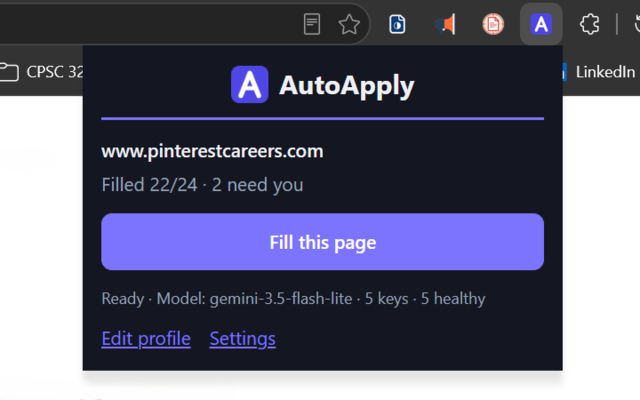
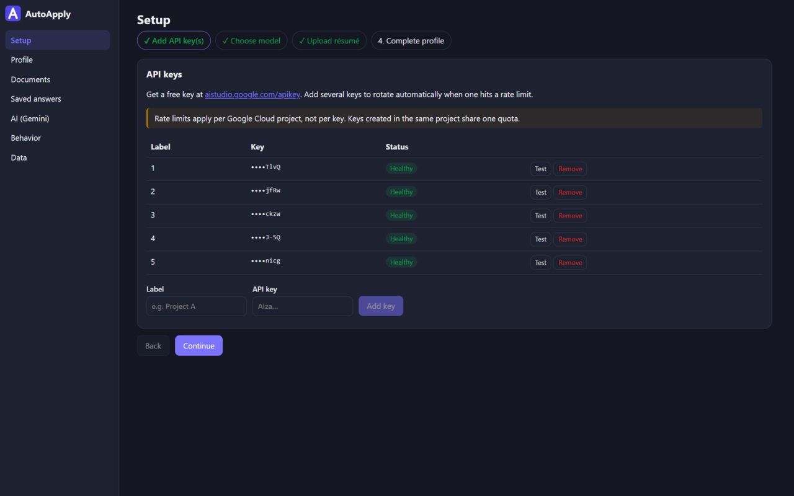
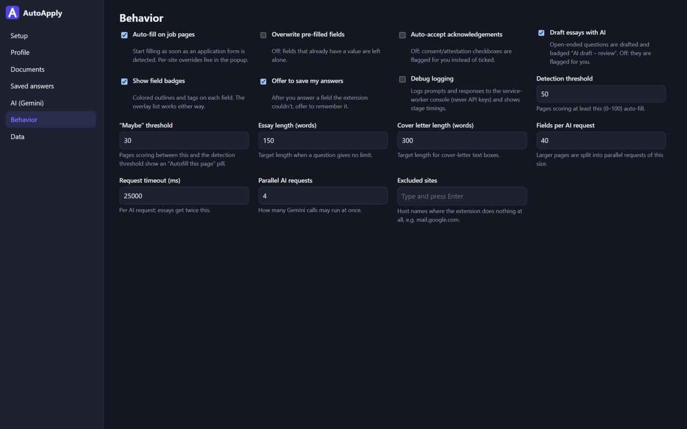

<div align="center" markdown="1">


# AutoApply

A Chrome extension (Manifest V3) that fills job applications on any website from your profile, using Google Gemini with your own API keys, or Claude with your own Claude Pro or Max plan (through Claude Code). It fills; **you** review and submit.

[](https://developer.chrome.com/docs/extensions/mv3/)
[](https://www.typescriptlang.org/)
[](https://preactjs.com/)
[](https://ai.google.dev/)
[](https://www.gnu.org/licenses/gpl-3.0)

### Check it out! [AutoApply on Chrome Web Store](https://chromewebstore.google.com/detail/autoapply/bhonoldmpmcmajclbndlpkijmnklgnlf)

</div>

## Table of Contents

- [App Preview](#app-preview)
- [Features](#features)
- [Install](#install)
  - [Get Gemini API keys](#get-gemini-api-keys)
  - [Choose a model](#choose-a-model)
  - [Or use your Claude plan](#or-use-your-claude-plan)
  - [Fill in your profile](#fill-in-your-profile)
  - [How filling works](#how-filling-works)
- [Badge meanings](#badge-meanings)
- [YOLO mode](#yolo-mode)
- [Privacy](#privacy)
- [Limitations](#limitations)
- [Troubleshooting](#troubleshooting)
- [How It Works](#how-it-works)
- [Development](#development)
- [License](#license)

## App Preview

<div align="center">
  
  
</div>

<div align="center">
  
</div>

## Features

- **One-click Filling**: Click **Fill this page** or press **Alt+Shift+F** to fill an application on any site, including fields inside iframes and shadow DOM.
- **Semantic Matching**: Gemini picks dropdown, radio and checkbox options by meaning rather than exact wording, and operates custom dropdowns and typeaheads.
- **AI Essay Drafts**: Open-ended questions are drafted from your profile, résumé and the job description, within the question's word/character limits.
- **Saved Answers**: Answer a flagged question once and AutoApply can reuse your answer on future applications.
- **Multi-Key Rotation**: Add several Gemini API keys and set a fallback model; AutoApply switches automatically when a key hits its rate limit or quota.

## Install

Requirements: Node 20+ and Chrome/Chromium 120+.

```bash
git clone https://github.com/ExxML/AutoApply.git
cd AutoApply
npm install
npm run build          # produces dist/
```

1. Open `chrome://extensions`.
2. Turn on **Developer mode** (top right).
3. Click **Load unpacked** and choose the `dist/` folder.

The settings page opens on first install at the setup wizard.

Note: Other Chromium-based browsers that support Manifest V3 should also work, but only Chrome/Chromium is tested.

### Get Gemini API keys

1. Go to <https://aistudio.google.com/apikey> and create a key.
2. In AutoApply → **Setup** (or **AI**), paste it with a label and click **Add key**. The key is checked by fetching the model list; invalid keys are rejected with Google's error message.
3. Add more keys if you hit rate limits. AutoApply rotates to the next healthy key automatically when one returns a quota or rate-limit error.

> **Rate limits apply per Google Cloud project, not per key. Keys created in the same project share one quota.** To get more capacity, create keys in _separate_ projects. Free tier limits vary by model; see [Gemini API rate limits](https://ai.google.dev/gemini-api/docs/rate-limits) for up-to-date quotas.

Each key row shows a status chip: _Healthy_, _Cooling down until 14:32_, _Daily quota used for &lt;model&gt; until 00:00 PT_, _Invalid key_, or _Model unavailable on this key_. Daily quotas reset at midnight Pacific time.

### Choose a model

The model list is fetched live with your key and shows only text-in/text-out models that support `generateContent` (no embedding, image, audio, live, TTS or Gemma models), **newest-added first**. A Flash-Lite model is preselected because it is fast and cheap; picking a model runs a quick validation call (✓/✗). You can also set an optional **fallback model**, used automatically when every key is exhausted for the primary model. Click **Refresh list** to re-fetch (it also refreshes automatically once a day).

The newest Gemini models are often under heavy load, and rejected requests may still use up your quota. If consistency matters to you, use a slightly less popular model as your primary or fallback.

### Or use your Claude plan

With a Claude Pro or Max plan and no API key, pick **Claude** under AutoApply → **AI** → Provider. Everything that uses AI (autofill, essays, cover letters, résumé import, YOLO) then goes to Claude instead of Gemini; switch back any time.

1. Install [Claude Code](https://code.claude.com/docs/en/setup), run `claude` once in a terminal, and sign in with your Claude account.
2. Copy the setup command shown in AutoApply → **AI** and paste it into PowerShell (Windows) or Terminal (macOS/Linux). It installs a small bridge script (`%LOCALAPPDATA%AutoApplyclaude-bridge` or `~/.autoapply/claude-bridge`) and registers it with Chrome, Edge, Chromium and Brave as a [native messaging host](https://developer.chrome.com/docs/extensions/develop/concepts/native-messaging). **What this runs** shows the script; **Uninstall** removes it.
3. Click **Connect**. Chrome asks once to let AutoApply talk to apps on this computer, then a test call shows the model and how long it took.

Each AI request starts `claude -p` once with every tool, MCP server, plugin, hook and memory switched off, and nothing saved to disk. AutoApply never sees your Claude sign-in. Pick a model and effort for each kind of work under **Models**, which lists the models Claude Code offers your plan (if it shows only Haiku, Sonnet, Opus and Fable, run the setup command again for the full list): Haiku at Low effort answers fastest, and a fill waits on it. Each request also pays about a second of Claude Code start-up, so fills take longer than with Gemini Flash-Lite. Usage counts against your plan's limits; when you hit one, YOLO pauses until it resets.

### Fill in your profile

- **Setup → Upload résumé (PDF)**: it is attached to résumé/CV upload fields automatically, and its text (extracted locally with pdf.js) is given to Gemini as context. **Prefill profile from résumé** proposes values for empty profile fields only; tick what to keep.
- **Profile**: contact details, work authorization per country, education, co-op, experience, projects, skills, preferences, background, referral, self-identification and essay guidance. Every field explains how it is used. Changes save automatically.
- Yes/No questions have **Unset**, and sensitive ones also **Decline**: _Decline_ picks the "prefer not to say" option when the form offers it; _Unset_ means the field is flagged for you.
- **Documents**: upload PDF/DOCX/TXT (≤ 5 MB) and mark one PDF as the primary résumé.

> [!NOTE]
> Your profile, documents and saved answers are stored in your browser's local storage. Clearing your browser data or uninstalling AutoApply deletes them, so keep a backup with **Data → Export JSON** (tick **Include documents** to back up your files too).

### How filling works

1. Click **Fill this page** in the popup or press **Alt+Shift+F**. AutoApply never starts on its own; it scans the page (including iframes and shadow DOM) only when you ask.
2. Instant pass (no network): name, email, phone, address and links are matched from your profile; questions you answered before (saved answers) fill immediately.
3. Everything else goes to Gemini in one batched call. It picks options **by meaning** (e.g. "willing to relocate = yes" → "I am willing to relocate"), and custom dropdowns and typeaheads are operated one at a time.
4. Open-ended questions ("Why do you want to work here?") are drafted by Gemini from your profile, résumé and the job description, respecting word/character limits, and marked as AI drafts.
5. Multi-step applications: when the next step appears, click **Fill this page** (or press **Alt+Shift+F**) again. AutoApply does not watch the page between fills.
6. The panel at the bottom right shows progress, the model used, and a **Needs you** list; click a row to jump to the field. **Re-run** and **Stop** are there too. Press **Alt+Shift+W** to expand or collapse it.
7. When you answer a flagged field yourself, AutoApply offers to **save the answer** for future applications (see **Saved answers** in settings).

## Badge meanings

| Badge                | Meaning                                                                                                                                |
| -------------------- | -------------------------------------------------------------------------------------------------------------------------------------- |
| Green ✓              | Filled from your profile or a saved answer ("You"/"Saved" once you answered it yourself)                                               |
| Blue **AI**          | Filled by the AI's semantic match (hover for the profile fields used and the chosen option)                                            |
| Purple **AI draft**  | AI-written essay — review it. Click the tag to save it as a reusable answer                                                            |
| Yellow **Needs you** | Unknown, low confidence, a consent/acknowledgement box, a sensitive field, or the AI declined. Hover for the reason and any suggestion |
| Orange **Check**     | The page shows something different from what was entered                                                                               |
| Red **Failed**       | Could not be filled                                                                                                                    |

Required consent and attestation boxes (privacy notice, terms, attestations) are **ticked automatically** by default; turn off _Auto-accept required consents_ in **Behavior** to have them flagged instead. _Optional consents_ (contact about other jobs, talent community, marketing) are set separately: auto-decline (default), auto-accept, or flag for you.

## YOLO mode

Turn on **YOLO mode** in the popup (set it up under **Settings → YOLO mode**) and AutoApply finds new postings and applies to them by itself while the browser is open. It works in a hidden page, so nothing opens on screen.

- **Where it looks**, every 30 minutes by default: GitHub job lists (the SimplifyJobs internship list by default), LinkedIn, Indeed and Glassdoor searches for your queries and locations, and any company career sites you add (Workday, Greenhouse, Lever, Ashby and SmartRecruiters boards through their APIs, any other career page by its links). Postings are kept when the title matches a query, the location fits, and it was posted recently. An optional Gemini check drops ones whose level or requirements rule you out. Board postings are applied to on the employer's own site; Easy Apply isn't supported yet.
- **How it applies**: it clicks Apply, signs in or creates an account (Workday needs one per company), fills every page, clicks Next until the review, and submits. Fields your profile can't answer get Gemini's best answer for an interview instead of being left blank. They're badged **Check** and listed with the application.
- **What it never does**: solve CAPTCHAs, or make up ID or payment numbers. Those jobs wait under **Applications** as **Needs you** with a desktop notification; **Resume** opens the job in a tab and carries on once you've done your part.
- **Accounts and email**: site passwords are generated, encrypted with a key that never leaves this browser, and listed in settings. Verification codes are read from the Gmail inbox signed in to this browser. Verification links need a (free, read-only) Gmail API client ID; the settings page walks through it.
- **Limits and duplicates**: a daily cap (25 by default; 0 finds jobs without applying), and a log of every application, yours included. No job is applied to twice, even when found on several sites; you choose whether YOLO may re-apply to jobs you submitted yourself, and whether filling one YOLO already applied to warns you.
- **Cost**: nothing runs between checks. A check is a few requests (an unchanged GitHub list answers "not modified"), and applying uses one hidden page at a time, closed when the queue is empty. Gemini use is the normal fill's plus one call per page for guesses.

## Privacy

Your profile, documents and settings live only in this browser (`chrome.storage.local`). YOLO mode also keeps its application log and encrypted site passwords there; it reads job boards logged out, and reads verification emails only while a run waits for one. To answer questions, the extension sends your profile, résumé text, saved answers and the page's field labels/job description **to Google Gemini under your own API keys** (or, if you chose Claude, to Anthropic through your own Claude Code); there is no AutoApply server, analytics or telemetry. API keys stay in the extension's background worker — web pages and content scripts never see them, they are masked after entry, and exports exclude them unless you tick **Include API keys**.

## Limitations

- Custom calendar date pickers that refuse typed input are flagged ("Pick the date manually").
- CAPTCHAs, passwords, payment fields and government ID numbers are never filled.
- Some sites reject synthetic events (mostly heavily customized widgets); those fields are marked _Failed_ or _Check_.
- Upload dropzones inside cross-origin iframes or that only accept real OS drag-and-drop may need a manual upload ("Upload the file manually").
- Outside YOLO mode it never submits or navigates: you always click Next/Submit yourself.

## Troubleshooting

- **"The model is overloaded" (503)**: requests are retried, then the **fallback model** is used if you set one (AI settings). Choosing a different primary model also helps.
- **"All API keys are rate-limited … Next retry possible at …"**: you hit a quota. The panel retries automatically if the reset is within 90 s. Add keys from **separate Google Cloud projects**, or wait for the daily reset (midnight Pacific).
- **"Model unavailable on this key"**: the model is not on your key's tier/region; pick another model.
- **"No API key" / "No model selected"**: open the AI settings from the panel's button.
- **"Claude bridge isn't installed" / "set up for another copy of AutoApply"**: run the setup command in AutoApply → AI again (the second happens when an unpacked AutoApply folder moves, which changes its ID).
- **"Claude Code isn't signed in"**: run `claude` in a terminal, sign in with `/login`, then click **Test connection**. **"Claude Code is too old"**: run `claude update`.
- **"Claude usage limit reached"**: your plan's limit; it lifts at the time shown. Switch the provider to Gemini to keep going meanwhile.
- **Nothing happens on a page**: use **Fill this page** in the popup (or **Alt+Shift+F**), check that the site isn't excluded (Behavior), and reload pages that were open before the extension was installed or updated.
- Turn on **Debug logging** (Behavior) to see per-stage timings in the panel and prompts/responses in the service-worker console (keys are never logged).

## How It Works

```
User clicks "Fill this page" (or presses Alt+Shift+F)
        │
        ▼
Content script scans the page, iframes and shadow DOM for fields
        │
        ▼
Instant pass (no network): profile values and saved answers filled
        │
        ▼
Remaining fields sent in one batch → background service worker
        │   Adds profile + résumé text, calls Gemini with a healthy key
        ▼
Gemini returns a decision per field: fill / essay / consent / needs you
        │
        ├── fill  → value entered, then verified against the page
        └── essay → drafted in a follow-up Gemini call, then entered
        │
        ▼
Badges + bottom-right panel show results; user reviews and submits
```

## Development

```bash
npm run build       # type-check + production build → dist/
npm run lint        # eslint + prettier --check
npm test            # unit tests (Vitest + happy-dom)
npm run test:e2e    # build, then end-to-end tests with the unpacked extension and a mocked Gemini
npm run test:live   # build, then a smoke test against the real Gemini API
```

**End-to-end tests** use Playwright's bundled Chromium in its new headless mode (`channel: "chromium"`), which supports extensions, so no display server or `xvfb` is needed. Run `npx playwright install chromium` once. Fixture pages in `test/fixtures` are served on ports 5501 and 5502 (for a cross-origin iframe); `test/mockGemini.ts` intercepts `generativelanguage.googleapis.com` (including the service worker's requests) and can simulate per-minute and daily 429s, `limit: 0`, 503s, invalid keys and slow responses.

**Live smoke test** (`npm run test:live`) runs `semantic.html` and `plain.html` against the real API and asserts the semantic selections (relocation, negatively phrased sponsorship, EEO decline). It is skipped unless `GEMINI_API_KEY` is set; `GEMINI_MODEL` overrides the model (default: the first Flash-Lite model in the live list).

```bash
# PowerShell
$env:GEMINI_API_KEY = "AIza..."; npm run test:live
# bash
GEMINI_API_KEY=AIza... npm run test:live
```

See `DECISIONS.md` for design choices and deviations from the specification.

## License

This project is licensed under the [GNU General Public License v3.0](LICENSE).
